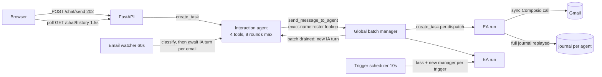

# 01: The problem and the evidence

## What OpenPoke is

OpenPoke is an open-source, single-user email assistant modelled on Poke. The user chats with one **interaction agent** (IA). The IA hands work to persistent, named **execution agents** (EAs). EAs act on Gmail through Composio and can schedule reminders (triggers). A background watcher flags important new mail without being asked.

Everything runs on one asyncio event loop. LLM calls (async httpx) overlap, but Composio calls are synchronous and freeze the loop. All coordination state lives in memory.

## What "agent overload" means here

It is not one bug. It falls into three classes:

1. **Load amplifiers.** Independent mechanisms that multiply LLM calls, tokens, concurrency or wall time (M3–M6, M8).
2. **One design weakness: identity and memory.** An agent is only a free-text name, reused only on an exact string match, with no description (M1). Each agent replays its whole journal into every prompt, and that journal truncates exactly the identifiers that follow-ups need (M2). Two runs of one agent can overlap (M7).
3. **A missing safety property.** External side effects (sends, replies, forwards) have no identity. Nothing stops the same email from going out twice. Confirm-before-send exists only in prompt text.

## Mechanisms

Ranked by likelihood × impact × evidence.

| ID | Mechanism | Class | Where | Evidence |
|---|---|---|---|---|
| **M1** | An agent is only a name: reuse needs an exact string match, the IA sees every name ever created (names only), and nothing is retired. | Identity | `interaction_agent/tools.py` (`send_message_to_agent`), `interaction_agent/agent.py` (`_render_active_agents`), `execution_agent/agent.py` (purpose = `"Handle tasks related to: {name}"`) | Roster cost measured (below). **L3 baseline: the model over-merges.** It sends unrelated work to whatever agent exists. In S1, "Priya Patel Auto Renewal" also handled the CL-2291 claim and the umbrella question. In S3, one "Sarah Chen" agent handled both Sarah Chens. In S4, seeded near-miss agents received the gold work 15 of 15 times. |
| **M2** | The whole journal is replayed into every EA call. Tool args are cut to 200 chars and results to 500, which drops ids while full prose answers are kept. | Memory | `execution_agent/agent.py` (`build_system_prompt_with_history`, `record_tool_execution`), `execution_agent/runtime.py` (no `conversation_limit`) | EA prompt grows linearly (measured below; characterization test `test_m2_journal_growth_baseline`). A follow-up that needs a truncated thread id has to re-search Gmail (`test_follow_up_search_calls_drop`). |
| **M3** | A turn ends only on a tool-free response, and `wait` is a tool, so the IA busy-waits with LLM calls. | Amplifier | `interaction_agent/runtime.py` | Observed in the original trace: 7 of 15 calls were `wait`, and turn 1 used all 8 rounds. **Re-observed live** (L3 baseline, S9): rounds 3–8 were all `wait` and the turn hit the limit. The limit was hit in every L3 scenario (§03). |
| **M4** | Nothing limits how much work starts: one task per dispatch, one task and one IA turn per due trigger, serial IA turns per important email inside the watcher poll, and no LLM retries. | Amplifier | `interaction_agent/tools.py`, `trigger_scheduler.py`, `importance_watcher.py`, `openrouter_client/client.py` | Reproduced: E4, E7 |
| **M5** | Synchronous Composio calls block the single event loop. | Amplifier | `execution_agent/tools/gmail.py`, `importance_watcher.py`, `search_email/tool.py`, `gmail/client.py` | Reproduced: E1 (1.5 s freeze) |
| **M6** | One global result batch couples unrelated work. Fast results wait for slow ones, and the batch never drains under continuous arrival. | Amplifier | `execution_agent/batch_manager.py` | Reproduced: E2, E3 |
| **M7** | Two runs of the same agent overlap: both read stale history, the journal interleaves, and both may act on the same thread. | Memory / safety | `batch_manager.py`, `log_store.py` | Reproduced: E5 |
| **M8** | Every agent gets all 13 tools (about 2.3k tokens of schemas per EA call), including send tools on read-only agents. | Amplifier | `execution_agent/tools/registry.py` | Measured (below). Deferred, see 04. |

### Reproduced experiments

These are L2 characterization tests: real orchestration code, a scripted LLM with fixed latencies, and a synchronous fake Gmail. The file is `tests/mechanism/test_baseline_characterization.py`, and every test is paired with a fix test.

| # | Scenario | Baseline result (test asserts) |
|---|---|---|
| E1 | One agent sends an email (1.5 s Composio call) while another makes a 0.3 s LLM call | Loop stalled ≥ 1.4 s. The 0.3 s agent finished after ≥ 1.5 s. |
| E2 | A user task (0.5 s) and an unrelated trigger task (6 s) arrive together | The fast result was delivered after ≥ 5.5 s |
| E3 | A, B, C dispatched 2 s apart, 3 s each | One IA turn with all 3 results. A was delivered after ≥ 6.5 s. |
| E4 | 20 triggers due in one poll | 20 concurrent runs, 20 IA turns, 40 IA LLM calls |
| E5 | The same agent dispatched twice, back to back | Both runs saw 0 earlier answers. Journal order: request, request, response, response. |
| E6 | Send, then a slow LLM call, with the run timeout lowered to 3 s | 1 email sent. The run was reported `[FAILED] … timed out`. |
| E7 | 10 important emails in one watcher poll | 10 serial IA turns inside the poll. The poll took ≥ 7.6 s. |

### Measured sizes

These are estimates: OpenPoke's own prompt builders, tokens ≈ chars ÷ 4.

| Item | Chars | ≈ Tokens |
|---|---|---|
| IA system prompt | 10,424 | 2,606 |
| IA tool schemas (4) | 2,103 | 526 |
| EA template | 3,744 | 936 |
| EA tool schemas (13) | 9,188 | 2,297 |

The roster block in every IA call grows linearly with agents:

| Agents | Chars | ≈ Tokens |
|---|---|---|
| 10 | 489 | 122 |
| 100 | 4,789 | 1,197 |
| 500 | 24,389 | 6,097 |
| 2,000 | 98,889 | 24,722 |

The EA system prompt grows linearly with the runs of one agent. Each run below is a copy of one real run (content not reproduced here):

| Runs | ≈ Tokens (full journal) | ≈ Tokens with a 5-request window |
|---|---|---|
| 1 | 1,802 | 1,802 |
| 10 | 9,494 | 5,221 |
| 30 | 26,590 | 5,221 |
| 90 | 77,874 | 5,221 |
| 180 | 154,802 | 5,221 |

The L3 baseline (MEASURED, telemetry) confirms the roster growth with the real model in the loop: the largest IA roster block was 492 chars at 10 seeded agents, 9,577 at 200 and 19,316 at 500.

## Other gaps found

- **Side-effect safety.**
  - Confirm-before-send is only prompt text (IA prompt line 5, EA prompt line 3).
  - `gmail_execute_draft`, `gmail_reply_to_thread` and `gmail_forward_email` run immediately, and every agent has them.
  - **Nothing prevents duplicate sends.** In the L3 baseline S8 scenario, a reply's response is lost and the user then says "did it go through? If not, send it again":
    - **original runs:** the injected fault fired in 2 of 3 repetitions, and both produced a second, duplicate email;
    - **re-run:** it fired in 1 of 3, with no resend;
    - **the re-run baseline's one duplicate** (S1) had a different cause: an earlier send the user never asked for (see 03).
  - **Sends the user did not ask for.** In both variants, an agent sometimes sent a reply when the user had asked only for a draft, to the correct recipient. `gmail_reply_to_thread` sends immediately, and confirm-before-send exists only in prompt text. Counts are in 03.
  - Email bodies (untrusted) reach agent contexts. Watcher summaries arrive at the IA as agent messages.
- **Dishonest timeouts.** `wait_for` cancels a run after it may already have sent an email, and the IA is told `[FAILED] … timed out` (E6). The user retries and the email goes out twice.
- **Triggers can double-fire.** `next_trigger` advances only after success and `_in_flight` is in memory, so a crash after a send re-fires the trigger on restart.
- **Silent failures.**
  - IA turns that die are only logged.
  - The web UI stops polling after 30 attempts.
  - Classifier errors silently mark emails as seen.
- **No observability.** Token usage was discarded, and nothing correlated a user turn with its agents, tools and side effects.
- **Smaller pre-existing issues.** These are documented, not fixed: they are outside overload scope.
  - `task_email_search` serializes results with `json.dumps`. That fails on the `datetime` timestamp, so the search sub-agent receives a Python `repr` string instead of JSON (`search_email/tool.py::_safe_json_dumps`).
  - `gmail_internal.gmail_fetch_emails` is unreachable, and it would raise `TypeError` if called (positional `arguments` to a keyword-only parameter).
  - Trigger runs never journal their request.
  - Log timestamps mix time zones: the first entry is written in UTC before the browser sets the timezone.
