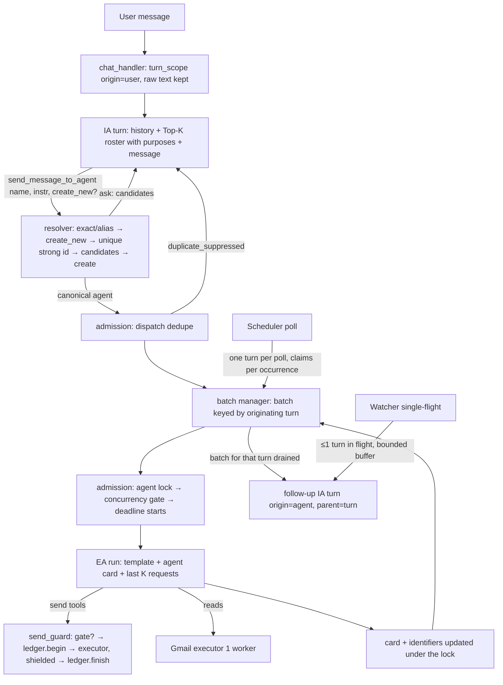
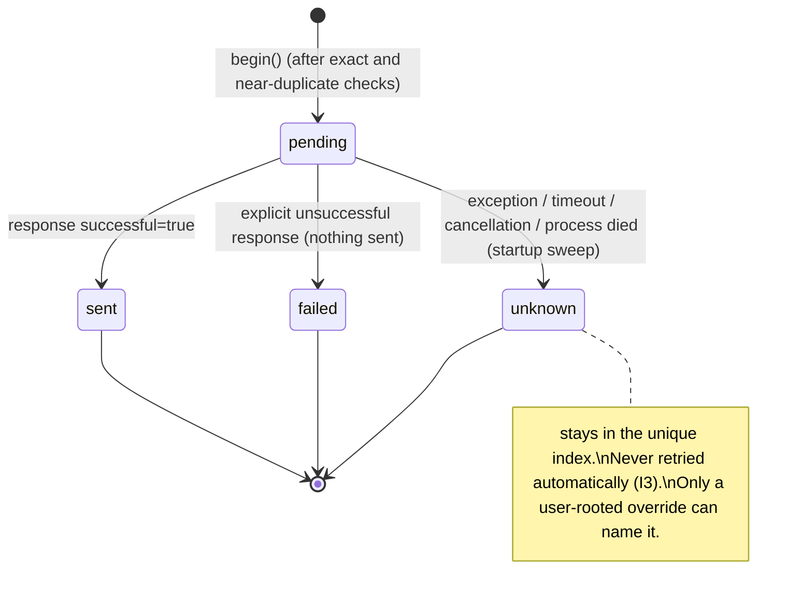
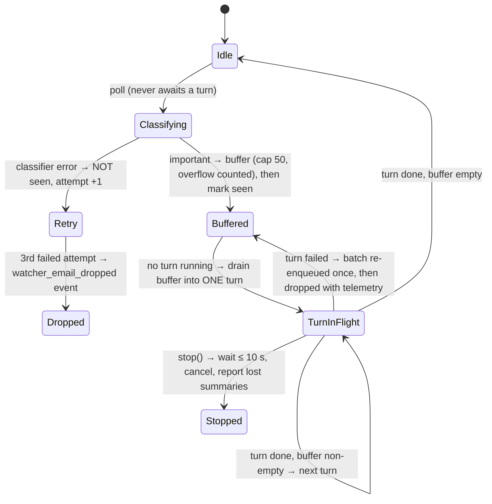

# 02: Design

Every behaviour change sits behind a flag that defaults to **off**. With every flag off, OpenPoke behaves exactly as before. A parity test proves this: it runs the same scripted scenario on the `baseline-pre-fixes` tag and on the current tree and compares the persisted state. `OPENPOKE_FIXES=all` enables every fix except the send gate.

## Principles

1. **One shared representation for identity and memory.** The agent registry and card serve routing (M1) and memory (M2). Fixing routing alone would make journals grow faster.
2. **Code proposes, the model decides.** Identity resolution routes automatically only on identity-level evidence. Fuzzy evidence produces candidates, never a route. There are no numeric similarity thresholds anywhere.
3. **Locking ≠ idempotency.** These are three separate mechanisms:
   - per-agent locks serialize runs;
   - dispatch dedupe suppresses exact repeats;
   - the ledger makes external sends at-most-once.
4. **Side effects are at-most-once and never auto-retried when ambiguous.** Retries apply only to LLM calls, which have no side effects.
5. **Honest status.** A run that sent, or may have sent, an email is never reported as plain `[FAILED]`.
6. **Simple, single-owner modules.**
   - Every constant lives in `server/overload_config.py` (env-overridable, with its rationale).
   - Every flag lives in `server/flags.py`.
   - Each responsibility has exactly one owner module (below).
7. **No new runtime dependencies.** Only `pytest` was added, as a dev dependency. Everything else is the standard library: `sqlite3`, `asyncio`, `contextvars`, `concurrent.futures`, `hashlib`.

## Target architecture (all flags on)



### Dispatch sequence (all flags on)

```mermaid
sequenceDiagram
  participant IA as Interaction agent
  participant T as send_message_to_agent
  participant R as resolver
  participant D as dedupe
  participant B as batch manager
  participant A as admission (lock, gate)
  participant E as execution agent
  participant L as ledger
  IA->>T: agent_name="Patel reply", instructions mention thread T
  T->>R: resolve
  R-->>T: route to "Priya Renewal" (unique owner of T), alias recorded
  T->>D: (priya-renewal, sha(normalized instructions))
  D-->>T: new → register running
  T->>B: create tracked task; returns {status: submitted, agent_name: canonical, routed: identifier}
  B->>A: agent lock, then gate slot (queue time reported, not charged)
  A->>E: run with card + last 5 requests, deadline = now + 90 s
  E->>L: begin(send intent) → Started | Blocked | ConfirmationRequired
  L-->>E: Started
  E->>E: Composio call on the Gmail executor, shielded; done-callback records sent/failed/unknown
  E-->>B: result (honest [PARTIAL]/[UNKNOWN] if it stopped after or during a send)
  B->>B: update card under lock, release lock and slot
  B-->>IA: when this turn's batch drains: new IA turn (child of the dispatching turn)
```

### Module map (single owner per responsibility)

| Responsibility | Owner |
|---|---|
| Data paths | `server/paths.py` |
| Flags and their prerequisites | `server/flags.py` |
| Tunable constants | `server/overload_config.py` |
| Test/eval clock | `server/utils/clock.py` |
| Tracked background tasks | `server/utils/tasks.py` |
| Startup and shutdown hooks | `server/lifecycle.py` |
| Correlation (turn/run ids, origin, deadline) | `server/services/context.py` |
| Telemetry | `server/services/telemetry.py` |
| Running Composio calls off the loop | `server/services/gmail/executor.py` |
| Real-vs-fake Gmail routing | `server/services/gmail/client.py::execute_gmail_tool` (single switch) |
| Duplicate side-effect prevention and honest status | `server/services/safety/ledger.py` (+ `db.py` for SQLite access) |
| The one wrapper around external-send tools | `server/services/safety/send_guard.py` |
| Trigger occurrence claims | `server/services/safety/trigger_claims.py` |
| Human send authorization | `server/services/safety/approvals.py` |
| Identifier extraction | `server/services/agents/ids.py` |
| Agent identity, aliases, identifiers, lifecycle | `server/services/agents/registry.py` |
| Agent card | `server/services/agents/card.py` |
| Name resolution | `server/services/agents/resolver.py` |
| Roster ranking | `server/services/agents/ranking.py` |
| Run admission (locks, dedupe, gate) | `server/agents/execution_agent/admission.py` |
| Result batching | `server/agents/execution_agent/batch_manager.py` |
| Flag-scoped prompt snippets | `server/agents/interaction_agent/prompt_extensions.py` |
| Test doubles | `server/testing/{fake_gmail,scripted_llm,reset}.py` |

## The fixes

Each fix below lists the problem, the change, the alternatives considered, and the trade-offs. Flags use the `OPENPOKE_FIX_` prefix.

### Phase 0: foundations (no behaviour change)

- **Data-dir isolation (P0.1).** `data_dir()` honours `OPENPOKE_DATA_DIR`. The seven stores resolve their directory through it at import time, which is unchanged, so tests set the env var before importing `server`. New modules resolve it at call time.
- **Context (P0.3).** Turns and runs are ContextVars. The batch manager's follow-up turn previously inherited the *finishing run's* context; it now opens a child turn of the batch's originating turn. `loop.run_in_executor` does not copy ContextVars, so the Gmail executor copies them explicitly.
- **Telemetry (P0.4).** `emit()` never raises, and failures are counted. It records sizes and hashes only. Every LLM caller passes `role=`, and `llm_call` copies provider `usage` (tokens, cost) when present.

### 1.1 `WAIT_ENDS_TURN` (M3)

- **Change.** After all tool calls of a round have executed, end the turn if any of them was `wait`. `send_message_to_user` is deliberately not terminal: the real trace replied in round 1 and dispatched in round 2, so ending on a reply would drop work.
- **Rejected alternatives.**
  - Lowering the 8-round cap (3D): it doesn't stop the spin, only truncates it.
  - Removing `wait`: it would change the tool contract the prompt relies on.
- **Trade-off.** A model that calls `wait` and then wants to keep working must do it in the next turn. Agent results always arrive as a new turn, so nothing is lost. A flag-scoped prompt snippet states the contract.

### 1.2 `EA_HISTORY_WINDOW` (M2)

- **Change.** Keep the last K = 5 requests' entries (the existing `conversation_limit` semantics, so K counts the current request). Then drop the oldest whole entries until the history fits 40,000 chars. A single huge entry is truncated with a marker.
- **Evidence for K (U3).**
  - In the L3 baseline (original runs) the furthest-back fact any follow-up needed was 4 requests back (S3). K = 5 covers it including the current request. S1 needed 1 and 3 requests back; S5 needed 1.
  - Measured flat prompt: ~5.2k tokens (est.) at any run count, against ~155k tokens at 180 runs with the full journal.
- **Known limit.** On its own, the window forgets facts older than K. A strict-xfail test documents this (`test_window_only_forgets_draft_older_than_k`); the card (2.2) fixes it.

### 1.3 `KEEP_TOOL_IDS` (M2)

- **Change.** `ids.extract_from_tool_call` walks raw arguments and results structurally and never raises. In addition to the original truncated lines, each tool call journals a `<tool_ids>` entry with threads, messages, drafts and emails.
- **Deviation.** For list-of-email results, the entry also carries compact `refs` (message id, thread id, sender, subject ≤ 80 chars). A bare set of thread ids cannot tell a follow-up which thread is "the Harbor Law email".
- **Effect.** The scripted rational-model test shows the follow-up re-search disappears (`test_follow_up_search_calls_drop_fixed`).

### 1.4 `LLM_RETRY` (M4)

- **Change.** Retry HTTP 429/500/502/503/504, timeouts, connection errors, and a 200 whose body carries a 429/5xx error.
  - At most 3 attempts in total.
  - Delay = uniform(0, min(20 s, 1 s · 2ⁿ)) (full jitter). `Retry-After` is honoured, capped at 20 s.
  - Never retry when `now + delay + 10 s > run deadline`. The per-attempt timeout is min(60, remaining − 1), with a floor of 5 s.
  - Other 4xx are never retried.
- **Safety.** LLM calls have no side effects, which is the only reason retrying them is safe. This mechanism is never used for Gmail.

### 1.5 `GMAIL_READS_OFF_LOOP` and 1.9 `GMAIL_SENDS_OFF_LOOP` (M5)

- **Executor.** `run_gmail()` runs Composio calls on a dedicated executor with **one worker by default** (U5). Composio client thread safety is unverified, so calls stay serialized as they effectively were; only the event loop is freed.
- **Reads (1.5).** Read call sites and draft create/delete go through the executor. This covers the watcher fetch, the search fetch, EA read tools and the `/gmail/*` routes, including the profile fetch.
- **Sends (1.9).** Sends are harder: cancelling the awaiting coroutine does not stop the thread.
  - A send does not start if the run has less than `MIN_SEND_BUDGET_S` (15 s) left.
  - The future is wrapped in `asyncio.shield`.
  - A done-callback, registered before the shield, always records the outcome, even after the run was cancelled. If the run was cancelled, the callback also journals the send for the owning agent. If the run had already been reported `[UNKNOWN]`, it starts a late-completion notice turn.
  - Shutdown waits up to `SHUTDOWN_GRACE_S` (10 s) for in-flight sends. Any that are still running stay `pending`, and the next startup marks them `unknown`.
- **Rejected alternative.** A separate Gmail process (5C): it is more machinery than a thread pool, for the same effect.

### 1.6 `AGENT_LOCK` (M7) and 1.7 `DISPATCH_DEDUPE`

- **Locks (1.6).**
  - Process-global `asyncio.Lock` per journal slug. Names that share a journal share a lock.
  - The request is journaled inside the lock, so journals alternate request/response and queued requests never leak into a running agent's history.
  - The deadline starts after the lock (I12).
- **Dedupe (1.7).**
  - Key = (slug of the canonical agent, sha256 of the stripped, lowercased, whitespace-collapsed instructions).
  - An entry lives while the run is in flight plus 120 s after it completes (U6).
  - It catches only exact repeats; reworded duplicates are the ledger's job.
  - The state is in memory; after a restart the ledger still protects sends.

### 1.8 `SEND_LEDGER` (D2), honest timeouts, trigger claims

**Ledger**: `data_dir()/safety.db`, schema in [Appendix D](00_SPEC.md#appendix-d-sqlite-schemas). A send runs only if `ledger.begin()` returns `Started`.



- **Fingerprint.** sha256 of the canonical JSON (action, target, recipients, subject, body hash).
  - Recipients are lowercased, deduplicated and sorted, including cc, bcc and extra recipients.
  - The body has line endings and whitespace normalized.
- **Targets.**
  - A reply targets its thread; a forward targets its message.
  - A send-draft uses the draft's recorded metadata (thread, recipients, subject, body hash), captured when the draft was created.
  - A draft created outside OpenPoke has no metadata, so its identity is `draft:<id>` and it has no near key.
- **I2 is enforced by the database.** A partial unique index on `fingerprint WHERE status IN ('pending','sent','unknown')`. A second identical send is `Blocked`.
- **Near duplicates.** `email|<thread or new>|<recipients>[|<subject> if new]` or `forward|<message>|<recipients>`. Reply and send-draft share the `email|` space, so a regenerated draft is caught. A match within 24 h returns `ConfirmationRequired`.
  - The check runs inside a `BEGIN IMMEDIATE` transaction under a process lock. That closes the check-then-insert race [the spec](00_SPEC.md) flagged: two agents cannot both pass the near check.
- **Overrides.** `confirm_duplicate_of` (schema-scoped to this flag) is accepted only when `root_origin == "user"`. An exact-duplicate override is stored with fingerprint `…#override:<id>`, so it is itself at-most-once.
  - This is duplicate protection, not authorization: a model in a user-rooted chain could still set it. Human authorization is the send gate (1.10).
- **Exceptions.** An exception mid-send returns `outcome_unknown` to the agent instead of raising. The row becomes `unknown`.
- **Honest results.** After every run the batch manager reads the ledger:

  | Run outcome | Ledger state for the run | Reported as |
  |---|---|---|
  | Failed or timed out | A send `pending` or `unknown` | `[UNKNOWN] … Do not retry; the user must confirm.` |
  | Failed or timed out | A send `sent` | `[PARTIAL] Completed before stopping: … Remaining work did not finish.` |
  | Succeeded | A send left in doubt | `[UNKNOWN]`, not `[SUCCESS]` (I4 extended) |

  A flag-scoped IA prompt snippet explains `[PARTIAL]` and `[UNKNOWN]`.
- **Trigger claims.** `(trigger_id, scheduled_for)` is INSERT-or-fail before an occurrence runs.
  - On scheduler start, `claimed` rows (the process died mid-run) become `abandoned`. Each one is advanced: a recurring trigger gets its next occurrence after `scheduled_for`; a one-off has `next_fire` cleared.
  - One IA turn then reports what was interrupted, including that run's ledger summary. Nothing is silently re-run or silently dropped (U10).
  - A run cancelled at shutdown leaves its claim `claimed`, so it is reported on the next start.
- **History delete.** DELETE `/chat/history` clears the claims but **not** the ledger, which is a safety record (U12).

### 1.10 `SEND_GATE` (off by default, not in `all`)

- **What it adds.** The ledger decides that a send happens *at most once*. The gate decides whether it may happen *at all* without a human.
- **Flow.**
  - With the gate on, the three send tools never execute. They store the exact action and arguments as an approval (6-char code from an unambiguous alphabet, 15 min TTL, single use) and return `approval_required`.
  - The IA tool `approve_action` exists only with the flag on. It executes the **stored** arguments verbatim through the ledger, and only when all of these hold:
    - the current turn is a user turn;
    - the code appears in that turn's **raw HTTP-received** message;
    - the approval is pending and unexpired.
- **Why it holds.** A compromised or confused model cannot forge the user's HTTP message. The L2 prompt-injection test (`test_injected_email_cannot_send_without_the_users_code`) shows 0 sends even when a fully compliant scripted model tries to approve on its own, and exactly one send of the stored action once the user types the code.
- **Open product questions (U1).**
  - Is origin-only approval (no code) acceptable?
  - Should reply and forward be forced through drafts?
  - What policy applies to scheduled sends?
  - These are left open; the gate is a complete, tested mechanism behind a flag.

### 2.1 `AGENT_REGISTRY`

- **Storage.** `execution_agents/registry.db` holds agents (canonical first-used name, unique slug, purpose, latest request, last outcome, run count, activity), aliases (normalized), identifiers (kind, value, state, first/last seen) and turn spawns.
- **Slug collisions.** A name whose slug collides with an existing agent becomes an alias of it; the two already share a journal.
- **Migration** (idempotent):
  - imports `roster.json` and trigger owners;
  - best-effort indexes each journal (`<tool_ids>` entries plus text-extracted ids, last activity, run count, purpose from the first request);
  - records unregistered (phantom) journals in `meta`;
  - writes nothing except `registry.db` (I7, file hashes asserted unchanged).
- **Roster facade.** `get_agent_roster()` returns a facade with the same methods. With the flag on it is backed by the registry and dual-writes canonical names to `roster.json`. Names written while the flag was off are synced back on load.

### 2.2 `AGENT_CARD`

- **Content.** Built by code, never by an LLM:
  - purpose (first and latest request);
  - counterparties (the account's own address excluded);
  - open drafts with thread, recipients and subject. A draft closes when a send-draft or delete succeeds, including sends approved through the gate or completed after a cancelled run;
  - recent threads;
  - active triggers;
  - last outcome;
  - runs and last activity.
- **Placement.** Rendered before the windowed history under `# Agent card (maintained by the system; may be incomplete)`.
- **Updates.** Updated after every run, inside the agent lock. Every field is HTML-escaped, because the fields derive from email content.
- **Failure handling.** If the card fails, the error is logged and counted, and the run continues without the card.

### 2.3 `RESOLVE_ON_WRITE` (M1)

**Resolution order:**

1. An exact name or alias, unless the name is generic, routes.
2. `create_new=true` creates. U11: the model's choice is honoured, and `route_override` is logged when step 3 would have matched.
3. Strong ids (thread, message or draft ids in the name or instructions) owned by exactly one agent route, unless that agent was spawned in this turn or is vetoed. The proposed name becomes an alias.
4. A shared content token in the name, or a shared counterparty email, returns `possible_existing_agents` with up to 3 candidates. They are ranked by (shared ids, shared emails, shared tokens, recency). Calling again with the same name in the same turn creates instead (loop guard).
5. Otherwise create. If the name is taken, the new agent gets a unique `#2` suffix.

**Definitions:**
- **Generic name.** No content tokens after removing the documented stopwords: `email, emails, mail, to, re, reply, draft, follow, up, followup, agent, task, the, a, an, about, for, with, and, of, on, in, new`. Single characters are also dropped.
- **Veto.** The instructions and the agent both have counterparty emails, and the two sets are disjoint.

**Effects:**
- D1 dedupe keys on the resolved canonical agent.
- The IA learns the canonical name from the tool result. A flag-scoped snippet explains the `ask` contract.

### 2.4 `TOPK_ROSTER` and 2.5 `DORMANCY`

- **Top-K.**
  - The IA sees K = 8 agents: the 3 most recently active, plus the best 5 by BM25 (k1 = 1.2, b = 0.75, textbook values, not tuned) against the current turn's text.
  - Each is rendered with last activity, run count and a ≤ 120-char purpose.
  - A `<more_agents count="N">` line tells the IA that unlisted agents are still matched automatically.
  - With at most K agents, all are shown.
- **Dormancy.**
  - Derived lazily: an agent idle for 14 days with no active trigger is dormant.
  - Dormant agents are hidden from Top-K but still resolved. Routing to one revives it, and journals are never deleted.

### 2.6 `TURN_BATCHES` (M6)

- **Change.** Batches are keyed by the originating turn id, and each drained batch starts a tracked follow-up turn that is the child of its turn. Flag off: the original single global batch.
- **Trade-off.** Two dispatches in one turn still share a batch, by design. M6 is about *unrelated* work. The paired E2 test therefore uses a user task and a trigger task arriving together.

### 2.7 `POLL_BATCH` (M4)

- **Change.** A scheduler poll opens one `trigger` turn. Every due occurrence is registered in that turn's batch **before** any of them starts, so the batch cannot drain early. Result: one IA turn per poll. Per-trigger claim, success and failure bookkeeping is unchanged.
- **Option.** A max-wait flush (`POLL_BATCH_MAX_WAIT_S`) is implemented and off by default; it is enabled only with evidence.

### 2.8 `WATCHER_SINGLE_FLIGHT` (M4)



The poll keeps its 60 s cadence. The important-email turn is a tracked task with a done-callback.

### 2.9 `CONCURRENCY_CAP` (M4)

- **Gate.**
  - A process-global gate allows C = 4 runs. User-rooted runs may take any free slot; other runs only while free slots exceed R = 1.
  - FIFO within each class, and user waiters are woken first.
  - The gate is acquired inside the agent lock (order: lock, then gate), and the deadline starts after both.
  - Cancelling a waiter removes it. A slot granted just before a cancellation is handed back.
- **Sizing (U4).** The gate can only protect a provider limit it is sized to. The S6 test uses a fake provider limit equal to C. With a limit below C, the remaining 429s fall to the retries.

## Flags (Appendix A)

| Flag | Task | Mechanism | Requires | In `all` |
|---|---|---|---|---|
| `WAIT_ENDS_TURN` | 1.1 | M3 | — | yes |
| `EA_HISTORY_WINDOW` | 1.2 | M2 | — | yes |
| `KEEP_TOOL_IDS` | 1.3 | M2 | — | yes |
| `LLM_RETRY` | 1.4 | M4 | — | yes |
| `GMAIL_READS_OFF_LOOP` | 1.5 | M5 | — | yes |
| `AGENT_LOCK` | 1.6 | M7 | — | yes |
| `DISPATCH_DEDUPE` | 1.7 | duplicate dispatch | `AGENT_LOCK` | yes |
| `SEND_LEDGER` | 1.8 | side effects | — | yes |
| `GMAIL_SENDS_OFF_LOOP` | 1.9 | M5 | `GMAIL_READS_OFF_LOOP`, `SEND_LEDGER` | yes |
| `SEND_GATE` | 1.10 | authorization | `SEND_LEDGER` | **no** |
| `AGENT_REGISTRY` | 2.1 | M1/M2 infrastructure | `KEEP_TOOL_IDS` | yes |
| `AGENT_CARD` | 2.2 | M1+M2 | `AGENT_REGISTRY`, `EA_HISTORY_WINDOW`, `KEEP_TOOL_IDS`, `AGENT_LOCK` | yes |
| `RESOLVE_ON_WRITE` | 2.3 | M1 | `AGENT_CARD` | yes |
| `TOPK_ROSTER` | 2.4 | M1 | `RESOLVE_ON_WRITE` | yes |
| `DORMANCY` | 2.5 | M1 | `TOPK_ROSTER` | yes |
| `TURN_BATCHES` | 2.6 | M6 | — | yes |
| `POLL_BATCH` | 2.7 | M4 | `TURN_BATCHES` | yes |
| `WATCHER_SINGLE_FLIGHT` | 2.8 | M4 | `GMAIL_READS_OFF_LOOP` | yes |
| `CONCURRENCY_CAP` | 2.9 | M4 | `AGENT_LOCK` | yes |

**Other switches:**
- `OPENPOKE_DATA_DIR`
- `OPENPOKE_TELEMETRY` (default 1)
- `OPENPOKE_FAKE_GMAIL`
- `OPENPOKE_FAKE_GMAIL_FIXTURE`
- `OPENPOKE_EVAL_CAPTURE_PROMPTS` (refused without fake Gmail)
- `OPENPOKE_ALLOW_LIVE_GMAIL_READS` (reserved for the U13 probe, which was not run)

`flags.validate()` runs at app startup and in the eval runner. It fails fast on unknown names, non-boolean values, missing prerequisites, and prompt capture without fake Gmail.

## Constants (Appendix B)

`python -m server.overload_config` prints this table from the code. Every value is env-overridable as `OPENPOKE_<NAME>` and validated. Chosen values and their evidence:

| Constant | Value | Rationale / evidence |
|---|---|---|
| `EA_HISTORY_REQUESTS` | 5 | **Confirmed by the L3 follow-up-reach probe** (max 4 requests back, S3). A ~5.2k-token (est.) flat prompt. |
| `EA_HISTORY_MAX_CHARS` | 40000 | Safety cap (~10k tokens est.) for single huge entries |
| `LLM_RETRY_MAX_ATTEMPTS` | 3 | Small cap; avoids amplifying storms |
| `LLM_RETRY_BASE_S` / `LLM_RETRY_MAX_DELAY_S` | 1.0 / 20 | Exponential with full jitter; the cap is well under the 90 s run deadline |
| `LLM_MIN_CALL_BUDGET_S` | 10 | Don't start a retry that can't finish before the deadline |
| `LLM_REQUEST_TIMEOUT_S` / `LLM_MIN_ATTEMPT_TIMEOUT_S` | 60 / 5 | Existing HTTP timeout; floor for deadline-derived timeouts |
| `EA_RUN_TIMEOUT_S` | 90 | Existing value, unchanged |
| `GMAIL_WORKERS` | 1 | U5: thread safety unverified; the probe was not run |
| `MIN_SEND_BUDGET_S` | 15 | Don't start a send the deadline may cut off |
| `SHUTDOWN_GRACE_S` | 10 | U9 |
| `DISPATCH_DEDUPE_WINDOW_S` | 120 | U6 |
| `NEAR_DUP_WINDOW_S` | 86400 | U7 (24 h) |
| `PENDING_STALE_AFTER_S` | 600 | Longer than any run (90 s) plus slack. Used by the runtime sweep on each scheduler poll. Process start sweeps every pending row, because a single process means nothing can be in flight at start. |
| `SQLITE_BUSY_RETRIES` / `SQLITE_BUSY_SLEEP_S` | 3 / 0.05 | "Database locked" handling. On persistent failure, nothing is sent. |
| `APPROVAL_TTL_S` / `APPROVAL_CODE_LENGTH` / `APPROVAL_SUMMARY_BODY_CHARS` | 900 / 6 / 200 | A 15 min validity. 31⁶ ≈ 8.9·10⁸ codes. 200 body chars shown. |
| `CARD_MAX_COUNTERPARTIES` / `CARD_MAX_THREADS` | 10 / 10 | Bound card size |
| `CARD_PURPOSE_CHARS` / `CARD_OUTCOME_CHARS` | 200 / 300 | Spec values |
| `IDS_PER_KIND_CAP` | 50 | Bounds journal growth on huge search results |
| `RESOLVER_MAX_CANDIDATES` | 3 | A short list the model can read |
| `TOPK_K` / `TOPK_HOT` / `TOPK_PURPOSE_CHARS` | 8 / 3 / 120 | Bounded roster (~8 × 60 tokens est.). **Measured in L3: flat at ~1.2k chars for 10, 200 and 500 agents** (original runs and re-run; 03). |
| `BM25_K1` / `BM25_B` | 1.2 / 0.75 | Textbook defaults, not tuned |
| `DORMANCY_DAYS` | 14 | U8 |
| `POLL_BATCH_MAX_WAIT_S` | 0 (off) | No evidence of a need |
| `WATCHER_BUFFER_MAX` / `WATCHER_CLASSIFY_MAX_ATTEMPTS` / `WATCHER_SHUTDOWN_GRACE_S` / `WATCHER_TURN_REQUEUE_MAX` | 50 / 3 / 10 / 1 | U9. The buffer equals the watcher's `max_results`. |
| `CONCURRENCY_TOTAL` / `CONCURRENCY_USER_RESERVED` | 4 / 1 | U4, **provisional**: no 429 was observed in any L3 run, so there was no evidence to size it |
| `TELEMETRY_MAX_BYTES` / `TELEMETRY_RING_SIZE` | 20 MB / 10000 | Bounded disk and memory |

One loop-guard horizon is derived rather than tuned: `MAX_TOOL_ITERATIONS × LLM_REQUEST_TIMEOUT_S`, the longest an IA turn can live.

## Schemas and deviations

SQLite schemas follow [Appendix D of the spec](00_SPEC.md#appendix-d-sqlite-schemas). Additions, each small and documented:
- **`registry.db`.**
  - `agents.latest_request` and `agents.last_outcome_at`, for the card's "latest request" and outcome time.
  - A `drafts` table (agent, draft id, thread, recipients, subject), so the card can show draft metadata even without the ledger.
- **`safety.db`.** As specified. Access is through `db.write()`: one connection per operation, `BEGIN IMMEDIATE`, a process lock, and retries on "database is locked".

## Deviations from [the spec](00_SPEC.md)

| Deviation | Why |
|---|---|
| The parity test extracts the baseline with `git archive` instead of a `git worktree` | Read-only, and leaves no worktree metadata. It is the same comparison. A negative control proves it detects a one-word behaviour change. |
| `<tool_ids>` carries compact `refs` for email lists | Bare id sets cannot be mapped to "which email". |
| `extract_from_text` also recognises Gmail draft ids (`r-<digits>`) | The resolver's strong-id step needs draft ids from instructions |
| Near-duplicate check is atomic (`BEGIN IMMEDIATE`) | Closes the cross-agent race [the spec](00_SPEC.md) asked to document |
| Successful runs with an in-doubt send are reported `[UNKNOWN]` | Stricter honesty than "only on failure" |
| A trigger run cancelled at shutdown keeps its claim `claimed` | It is reported as interrupted on the next start, rather than marked failed |
| E2 dispatches the fast and the slow task from two turns (user + trigger) | Turn-scoped batching keeps same-turn work together by design; M6 is about unrelated work |
| S5's 30 intervening dispatches are seeded synthetically | Bounds LLM spend. Seeded journals use only baseline-format entries, so both variants see identical data. |
| The L3 gate "routing accuracy at N = 200 ≥ N = 10" uses S4@10 and S4@200; S4@500 is also run | Cheap enough to include |

## Invariants and where they are tested

| Invariant | Test(s) |
|---|---|
| I1 flags off ≡ baseline | `tests/parity/test_parity.py` (+ negative control) |
| I2 no duplicate while `pending`/`sent`/`unknown` | `test_status_machine_and_partial_unique_index`, `test_exact_duplicate_reply_is_blocked` |
| I3 `unknown` never auto-retried | `test_unknown_is_never_retried_automatically`, `test_exception_mid_send_is_unknown_not_retried_and_reported` |
| I4 no plain `[FAILED]` after a send | `test_timeout_after_send_reports_partial`, `test_timeout_during_inflight_send_is_unknown_then_late_notice` |
| I5 one run per agent | `test_m7_same_agent_serialized_fixed`, `test_scheduler_path_serialized_with_chat_path` |
| I6 watcher single flight, bounded buffer | `test_burst_during_inflight_turn_is_buffered_into_one_next_turn`, `test_buffer_overflow_is_counted_and_reported`, `test_tasks_stay_bounded_across_many_polls` |
| I7 migration non-destructive | `test_migration_is_non_destructive_idempotent_and_complete` (file hashes) |
| I8 every agent and trigger owner resolvable | same |
| I9 no auto-route on fuzzy evidence | `test_reworded_name_without_ids_asks_with_the_right_candidate`, `test_generic_name_never_alias_routes_without_ids`, `test_strong_ids_shared_by_two_agents_ask_instead_of_routing` |
| I10 telemetry never fails a request | `test_i10_telemetry_failure_never_fails_a_request`, `test_emit_writes_jsonl_and_survives_unwritable_dir` |
| I11 background tasks tracked, surfaced, cancelled | `test_i11_*`, `test_stop_leaves_no_tasks_and_reports_lost_summaries` |
| I12 timeouts start after lock and gate | `test_timeout_excludes_lock_wait`, `test_i12_gate_wait_is_not_charged_to_the_run` |

## Traceability matrix

| Mechanism | Evidence (baseline) | Fix (flag) | L2 tests (paired) | Result |
|---|---|---|---|---|
| M3 wait spin | Trace: 7/15 calls were `wait`. L3: limit hit in every scenario with `openai/gpt-6-luna` (not with `anthropic/claude-haiku-5.5`). | 1.1 `WAIT_ENDS_TURN` | `test_m3_wait_spin_baseline` ↔ `test_m3_wait_ends_turn_fixed`, `test_s9_traced_request_calls_drop` | L2: 8 rounds → 1; S9 shape 16 → 5 IA calls. **L3: 102 limit hits → 0; IA calls per turn 5.2–6.0 → 2.0–3.0 in every scenario.** |
| M2 journal replay | Prompt grows linearly (measured); ids truncated | 1.2 `EA_HISTORY_WINDOW`, 1.3 `KEEP_TOOL_IDS`, 2.2 `AGENT_CARD` | `test_m2_journal_growth_baseline` ↔ `test_m2_journal_growth_flat_after_k`, `test_ea_prompt_flat_over_runs_with_card`. The window-only xfail ↔ `test_old_draft_found_on_card`. `test_follow_up_search_calls_drop(_fixed)` | L2: flat after K; old draft found via the card; re-search eliminated. **L3: context_hit 1.00 on S1 and S5; S3 0.40 → 0.60; S4@10 1.00 → 0.67 (the IA started no run; see 03).** |
| M1 identity | Roster grows linearly; L3 over-merging | 2.1–2.5 | `test_m1_roster_growth_baseline` ↔ `test_roster_tokens_flat_with_top_k`; resolver table tests; `test_s1_…`, `test_s2_…`, `test_s3_two_sarahs_never_merge` | L2: roster flat; Sarahs never merged by code. **L3: roster block flat at ~1.2k chars for N = 10/200/500 (baseline 0.5k/9.6k/19.3k). False merges 46/75 → 32/67 (S1 9/15 → 0/15); every remaining merge is the model typing an exact existing name. Hard gate FAILED (03).** |
| M4 unbounded starts | E4, E7, no retries | 1.4, 2.7, 2.8, 2.9 | `test_m4_trigger_storm_baseline` ↔ `test_m4_one_turn_per_poll`, `test_storm_peak_runs_capped`; `test_m4_watcher_serial_turns_baseline` ↔ `test_m4_watcher_burst_one_turn_poll_not_blocked`; `test_s6_storm_with_rate_limiter[False/True]` | L2: 20 turns → 1; peak 20 → ≤ 3 (trigger-rooted); watcher poll ≥ 7.6 s → < 1 s; storm with a rate limiter: baseline runs fail, fixed 0 failures |
| M5 blocking Gmail | E1 | 1.5, 1.9 | `test_m5_gmail_blocks_loop_baseline` ↔ `test_read_does_not_block_loop_fixed`, `test_sends_do_not_block_the_loop` | L2: stall ≥ 1.4 s → < 0.1 s |
| M6 global batch | E2, E3 | 2.6 `TURN_BATCHES` | `test_m6_*_baseline` ↔ `test_m6_fast_result_not_held_by_unrelated_slow_work`, `test_m6_staggered_turns_get_their_own_follow_ups` | L2: fast result 6 s → < 1.5 s; 1 turn → 3 |
| M7 overlap | E5 | 1.6 `AGENT_LOCK` | `test_m7_same_agent_overlap_baseline` ↔ `test_m7_same_agent_serialized_fixed` | L2: interleaved → alternating; the second run sees the first answer |
| Duplicate dispatch | — | 1.7 `DISPATCH_DEDUPE` | `test_identical_dispatches_*`, `test_dedupe_keys_on_the_canonical_agent` | L2: 2 runs → 1 |
| Duplicate sends / dishonest timeouts / trigger re-fire | E6. L3 S8 (original runs): 2 duplicates in the 2 baseline repetitions where the fault fired. | 1.8 `SEND_LEDGER`, 1.9 | `test_timeout_after_send_baseline` ↔ `test_timeout_after_send_reports_partial`; crash/restart tests | L2: `[FAILED]` → `[PARTIAL]`/`[UNKNOWN]`; duplicates blocked. **L3: duplicate sends 2 → 0.** |
| Prompt-only confirmation | Prompt text only | 1.10 `SEND_GATE` | `test_injected_email_cannot_send_without_the_users_code` | L2: 0 sends without the user's code |
